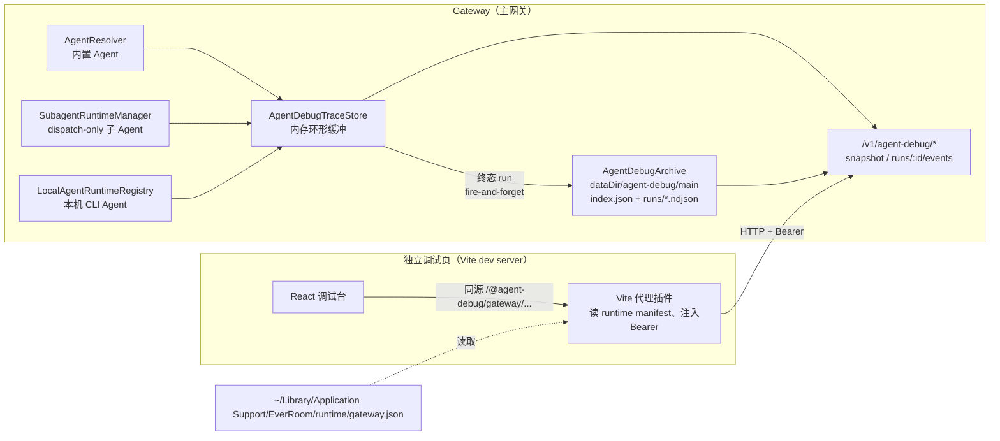

# Agent 调试页（独立浏览器调试台）

> 状态：已交付并独立验收（2026-10-23）；2026-10-24 增补「终态 run 磁盘归档 / 历史找回」
> 日期：2026-10-23（历史归档 2026-10-24）
> 范围：Gateway runtime 埋点 + 独立浏览器调试页（不进入产品导航、不落数据库）
> 设计细案：`docs/agent-debug-persistence.zh-CN.md`

## 1. 背景与目标

EverRoom 现在同时运行多类 Agent：内置 Agent（`main`/`knowledge`/`web-search`/`transcription-summary`/`diary` 等）、dispatch-only 子 Agent（`slides-planner`/`slides-layouter`/`slides-builder`/`doc-writer` 等）以及本机 CLI Agent（`codex`/`claude`/`openclaw` 经 ACP）。排查问题时只能分别看某一处：Agent Office 只有状态摘要，主对话时间线只能看当前会话，子 Agent 事件又散在 `subagent_invocation_events` 表里。

目标：提供一个**独立浏览器调试页**，可以：

1. 看到所有 Agent 的实时工作进度（谁在跑、跑到哪一步、成功/失败）；
2. 看每一次 run 的**工具调用**（参数、结果、耗时、错误）和**思考过程**（`reasoning.delta`）；
3. 随时切换跟踪的 Agent，查看不同 Agent 的执行流与最终输出；
4. **桌面应用重启后仍能找回历史 run**：终态 run 落盘归档，按「会话 / 时间 / 来源（本次 or 历史）」区分并回放（2026-10-24 新增）。

非目标：

- 不进入产品 UI 导航，不随 Desktop 打包发布；
- 不新增数据库表 / 迁移（持久化用 `dataDir/agent-debug/` 下的文件型归档）；
- 不改变任何 Agent 的业务行为与权限；
- 不做远程/多人共享（只绑 `127.0.0.1`）。

## 2. 总体架构



关键取舍：**只在 Gateway 的 runtime 边界埋点**。三个 runtime 创建/获取入口已经覆盖全部 Agent，业务模块无需改动：

| 入口 | 覆盖范围 | 埋点位置 |
| --- | --- | --- |
| `AgentResolver`（`trackedRuntime`） | 全部内置 Agent（含 `main`、模型档位、knowledge、web-search 等） | `createRuntime()` 返回后包一层 trace |
| `SubagentRuntimeManager` | 全部 dispatch-only 子 Agent | `createRuntime()` 返回处包一层 trace |
| `LocalAgentRuntimeRegistry` | 本机 CLI Agent（ACP） | `resolve()` 新建 runtime 时包一层 trace |

> developer 类型 Agent 在 `AgentResolver` 中也注册了定义（用于状态页），但其 runtime 来自 `SubagentRuntimeManager.acquire()`。为避免同一 run 被记录两次，`AgentResolver` 对 `kind === "developer"` **不再包 trace**。

主网关与补全专用网关（`cursor-completion-server`）各自创建自己的 store、归档目录与路由；调试页通过 manifest 自动发现多个网关来源。KnowledgeService 内部自建的 `AgentResolver` 也注入了同一个 store（`createKnowledgeAgentResolver(config.dataDir, config.llm, agentDebugStore)`）。

持久化取舍：**归档在 runtime 边界之外旁路完成**，不进入业务表。每个 Gateway 进程写自己的 `<dataDir>/agent-debug/<source>/`（`main` / `cursor-completion`），索引互不覆盖；archive 只接收「终态 run」，写入是 fire-and-forget 串行队列，失败只 warn，不影响 Agent 行为。

## 3. 数据面

### 3.1 契约类型

定义在 `@nxcore/agent-contract`：`AgentDebugAgent`、`AgentDebugRun`、`AgentDebugEvent`、`AgentDebugSnapshot`、`AgentDebugRunEvents`，以及 2026-10-24 新增的 `AgentDebugRunOrigin`（`live` / `archive`）、`AgentDebugArchiveInfo`。

`AgentDebugRun` 新增两个查询时补全字段（均为可选，兼容旧 Gateway）：

| 字段 | 含义 |
| --- | --- |
| `origin?: "live" \| "archive"` | 数据来源；缺省按 `live` 处理。`archive` = 来自磁盘归档的历史 run |
| `sessionTitle?: string \| null` | 会话标题（`agent_sessions.title`），用于按对话区分/找回；子 Agent / 会话已删除为 null。**不落归档**，每次查询时补全 |

### 3.2 AgentDebugTraceStore（内存环形缓冲）

常量（`apps/gateway/src/modules/agent-debug/trace-store.ts`）：

| 常量 | 值 | 含义 |
| --- | --- | --- |
| `MAX_EVENTS_PER_RUN` | 3000 | 每个 run 保留的事件条数上限 |
| `MAX_RUN_BYTES` | 8 MB | 每个 run 全部事件 payload 的累计字节上限 |
| `MAX_RUNS` | 150 | 全部 run 条数上限 |
| `MAX_EVENT_BYTES` | 64 KB | 单条事件 payload 序列化预算 |

行为：

- 单条 payload 超 64KB 时截断为字符串预览并记录 `truncatedBytes`；超限事件数/字节数从最旧事件淘汰，累计 `droppedEvents`（快照/事件响应里可见）。
- run 数超过 150 时优先淘汰最旧的**终态** run，无终态可淘汰才淘汰最旧运行中 run，累计 `droppedRuns`。
- 相邻同类 `reasoning.delta` / `message.delta` 合并为一条累计事件（**seq 不变**，payload 分片保存、读取时物化），避免流式 token 把缓冲冲爆。`reasoningChars` 只累计 `reasoning.delta` 字符数。
- 增量接口在返回 `seq > afterSeq` 的事件之外，还会额外带回**最后一条可合并的尾部事件**（其 seq 可能 ≤ `afterSeq`，内容仍可能在增长）；调试页必须按 seq **upsert**（替换同 seq 事件）而不是只追加。
- run 元数据在 `beginRun` 时确定，`finishRun` 补齐终态；终态只允许写一次（幂等）。若同一 `runId` 再次 `beginRun`（resume 复用 runId），保留已累计事件并把状态拉回 `running`、清空终态字段，保证下一次终态仍可回写。
- run 到达终态后 fire-and-forget 落盘归档（见 §3.5）；live run 在 snapshot 里带 `origin: "live"`，归档历史 run 带 `origin: "archive"`。
- `listRuns(limit, archived)`：`include`（默认）合并内存 run 与归档历史（同 runId 以内存为准、不重复）；`only` 只返回历史；`exclude` 只返回本次进程。排序仍是「运行中永远最前，其余 `startedAt` 倒序」。
- `getRun` / `listEvents` 在内存没有时回落到归档（历史 run 终态静态、无尾部 delta 重放）。
- `dispose()` 改为 async：仍处于 `running` 的 run 先按 `interrupted` 收尾并归档，再 `await archive.flush()` 等写盘队列排空，最后清空缓冲。Gateway 的 `onClose` 会 await 它。

### 3.3 埋点语义

trace 包装 `AgentRuntime.start()` / `resume()`（`apps/gateway/src/modules/agent-debug/instrument.ts`）：

1. run 开始时 `beginRun({ runId, agentId, agentName, agentKind, runtimeId, sessionId, pageLabel, task })`；
2. 事件流逐条 `recordEvent`（含 `reasoning.delta`、`tool.*`、`message.*`、`context.usage`、`run.*`）；
3. 收到 `run.completed/failed/cancelled/interrupted`、事件流抛错、消费者提前 `break` 或流结束无终态时 `finishRun`；
4. 事件原样向下游透传，**不改变顺序、不吞异常**；store 自身的任何异常都被吞掉，不影响 Agent 行为；
5. 同一 runtime 重复包装只生效一次（WeakSet + Symbol 标记）。

### 3.4 HTTP API

均走既有 Gateway Bearer 鉴权（`Authorization: Bearer <token>`），只读、无写操作。

| 方法 | 路径 | 参数 | 说明 |
| --- | --- | --- | --- |
| GET | `/v1/agent-debug/snapshot` | `runs`：整数 1–300，默认 150；`archived`：`include` / `only` / `exclude`，默认 `include` | Agent 目录 + 最近 run 摘要 + `droppedRuns` + `archive` 概况 |
| GET | `/v1/agent-debug/runs/:runId/events` | `afterSeq`：整数 ≥0，默认 0；`limit`：整数 1–5000，默认 1000 | 单个 run 的事件增量（内存 run 或归档历史 run）；返回 `{ run, events, latestSeq }` |

响应要点：

- `snapshot` = `{ generatedAt, agents, runs, droppedRuns, archive }`；`agents` 是 `AgentDebugAgent[]`（`id/name/description/kind/state/activeRunCount/lastRunAt`），`runs` 运行中优先、其余按 `startedAt` 倒序，`runs[i].eventCount` 是**缓冲/归档内保留**的事件数；`runs[i].origin` 区分本次与历史；`runs[i].sessionTitle` 为会话标题（查不到 null）。
- `snapshot.archive` = `{ enabled, retentionDays, runCount, bytes, oldestStartedAt }`；归档关闭时 `enabled=false`。
- `events` 按 seq 升序；`latestSeq` 是当前最大 seq（下一次 `afterSeq` 的上界参考）；页被 `limit` 截断时客户端应以**本页最后一条事件的 seq** 推进游标，而不是直接跳到 `latestSeq`。归档 run 的历史事件一次性读取（终态静态）。
- `snapshot.agents` 来源：主网关用 `AgentStatusService.snapshot()`（内置 + developer），再合并缓冲里观测到的本机 Agent；补全网关用 resolver 定义 + activity 推导。
- 边界：无/错误 token → `401`；未知（或已被缓冲淘汰且不在归档里的）run → `404`；`runs>300`、`limit>5000`、`archived` 非法取值 → `400`。

### 3.5 磁盘归档（历史找回，2026-10-24）

文件位置（不写数据库、不加迁移）：

```text
<dataDir>/agent-debug/main/                     # 主网关；补全网关为 cursor-completion/
  index.json                                    # { version: 1, runs: [{ run, file, bytes }] }
  runs/<YYYYMMDD>/<safeRunId>.ndjson            # 第 1 行 run meta，其后每行一个事件
```

- 写入时机：run 到达终态（`finishRun`）后异步写入；进程正常退出时 `dispose()` 会把仍在运行的 run 收尾为 `interrupted` 再落盘。**进程被 SIGKILL 时运行中的 run 不保证保留**。
- 原子性：先写 `.tmp` 再 `rename`；`index.json` 同样处理。写入串行排队、同 runId 幂等；异常只 warn，不影响 Agent 与 Gateway 启动。
- 自愈：`index.json` 缺失/损坏时扫描 `runs/**/*.ndjson` 首行重建；单个坏行/坏文件跳过。
- 保留：默认 **7 天 / 最多 2000 条 run / 总 1 GiB**，写入后即时从最旧开始裁剪。env 见 §4.1 后的配置表。
- 读取：历史事件仅在选中该 run 时按需读文件；`eventCount` 为本归档内事件数。
- 会话识别：run 记录 `sessionId`/`pageLabel`/`task`/`startedAt`；查询时批量补 `sessionTitle`，历史找回时可按「会话 + 绝对时间 + 任务摘要」定位。
- 关闭开关：`NXCORE_AGENT_DEBUG_ARCHIVE=0`（`false`/`off` 同义）时完全不写盘，调试页显示「历史未启用」并禁用历史入口。

Gateway 侧归档配置（`.env` / `.env.example`）：

| 变量 | 默认 | 含义 |
| --- | --- | --- |
| `NXCORE_AGENT_DEBUG_ARCHIVE` | `true` | 归档总开关；`0`/`false`/`off` 关闭 |
| `NXCORE_AGENT_DEBUG_ARCHIVE_DAYS` | `7` | 保留天数（1–3650） |
| `NXCORE_AGENT_DEBUG_ARCHIVE_RUNS` | `2000` | 最多 run 条数（1–100000） |
| `NXCORE_AGENT_DEBUG_ARCHIVE_MAX_MB` | `1024` | 归档总字节上限（MB，64–65536） |

> 归档是调试数据：只在本机、不加密、不进 Sentry；需要手动清理时可直接删除 `<dataDir>/agent-debug/<source>/`（Gateway 下次启动会从空索引开始）。

## 4. 独立浏览器调试页

### 4.1 启动方式

```bash
pnpm debug:agents        # 根目录；即 pnpm --filter @nxcore/desktop exec vite --config vite.agent-debug.config.mts
```

默认地址 **http://127.0.0.1:5199/debug/agent-debug.html**。等价方式：

```bash
cd apps/desktop && pnpm debug:agents
# 或直接跑 vite（CI/受限环境无 pnpm 依赖校验时用这个）：
node apps/desktop/node_modules/vite/bin/vite.js --config apps/desktop/vite.agent-debug.config.mts
```

环境变量：

| 变量 | 默认 | 作用 |
| --- | --- | --- |
| `AGENT_DEBUG_PORT` | `5199` | dev server 端口（`strictPort: true`，被占用即失败） |
| `EVERROOM_AGENT_DEBUG_MANIFEST` | — | 显式 manifest 路径；POSIX 用 `:`、Windows 用 `;` 分隔多个 |
| `NXCORE_DATA_DIR` | 平台默认数据目录 | 覆盖 manifest 自动发现的数据目录 |

调试页不进入 Electron renderer 构建产物，也不参与产品打包；`vite build` 只输出到 `apps/desktop/out/agent-debug/` 供验证。

### 4.2 网关发现与鉴权代理

Vite 插件 `agent-debug-gateway`（`configureServer` 里在 Vite 内部中间件之前挂载）：

- manifest 发现顺序（无效候选直接跳过，路径去重）：
  1. `EVERROOM_AGENT_DEBUG_MANIFEST`（相对路径按 cwd 解析）；
  2. `NXCORE_DATA_DIR`（缺省为 EverRoom 平台数据目录）下 `runtime/gateway.json` 与 `cursor-completion-service/runtime/gateway.json`；
  3. NxCore 独立网关数据目录下 `runtime/gateway.json`；
  4. 仓库 `.data/runtime/gateway.json`。
- 每次请求按 **mtime** 重读 manifest：Desktop 重启换了端口/token 会自动生效。
- `GET /@agent-debug/sources` 返回 `[{ id, label, baseUrl, version }]`，**不含 token**；manifest 无效/读取失败时通过 `x-agent-debug-warning` 响应头（URI 编码）带回可读提示。
- `GET /@agent-debug/gateway/:sourceId/*` 在同源内转发到对应 `baseUrl`，由 dev server 注入 `Authorization: Bearer <token>`；token 只存在于 Node 进程，不进浏览器、不进页面 bundle。
- 代理只接受 GET（其它方法 `405`）；无任何 manifest 时 `503`；未知 sourceId `404`。
- dev server 只监听 `127.0.0.1`（`server.host = '127.0.0.1'`）。

### 4.3 页面布局

```text
┌──────────────────────────────────────────────────────────────────────────┐
│ Agent · 来源 · 连接状态 · 范围(全部/本次/历史) · 归档概况 · 过滤 · 刷新 · 暂停 │
├──────────────┬──────────────┬────────────────────────────────────────────┤
│ Agent 列表   │ 该 Agent 的  │ Run 详情                                   │
│ 全部/内置/子 │ run 列表     │ ┌ 时间线：思考 / 工具调用 / 消息 / 系统事件 │
│ Agent/本机   │ 会话筛选     │ ├ 原始事件（事件列表 + JSON，点击查看）     │
│ 状态标记+次数│ 运行中置顶   │ └ 输出（最终消息 + 结构化结果）             │
│              │ 历史/时间/会话│                                            │
└──────────────┴──────────────┴────────────────────────────────────────────┘
```

交互：

- 左侧点选 Agent = **切换跟踪对象**；切换时 run 列表按 `agentId` 过滤，事件缓冲按 `sourceId + runId` 重置为 0 增量重新拉取；点「全部 Agent」看全局 run 流。
- Agent 类型页签：全部 / 内置（builtin）/ 子 Agent（developer）/ 本机 Agent（local）。
- 顶栏「范围」三态：`全部`（本次 + 历史，默认）/ `本次`（仅内存 run）/ `历史`（仅归档 run）。历史模式 snapshot 请求 `runs=300`，其它模式 150；切换即重新拉快照。归档关闭或旧 Gateway 不返回 `archive` 时显示「历史未启用」并禁用历史入口。
- 顶栏归档概况：`历史 N 条 · 保留 D 天`，hover 显示字节数与最旧时间。
- run 列表：每行显示状态、任务摘要、耗时/工具数/思考字数/事件数；历史 run 额外有「历史」文字标签与 `MM-DD HH:mm` 开始时间；会话标签显示 `sessionTitle`（回退 `pageLabel`），并始终附 `#短id`（sessionId 前 8 位），标题相同也能区分。
- 会话筛选与分组（2026-10-24 增强）：列表头「会话」下拉的每个选项是「主名 · 首次时间 · #短id」，主名优先 `sessionTitle`、缺失时用该会话首条 run 的任务摘要（比 `Home`/`Room` 更可辨认），hover 可看完整 sessionId / 时间范围 / run 数；「全部会话」视图下 run 列表按会话分组，组头（同样带时间与短 id）可点击直接筛选到该会话；筛选后顶部有「筛选：… / 全部会话」提示条，可一键回到全部。空态区分「无本次 run / 无历史记录 / 该会话暂无 run」。
- 浏览时锁序（2026-10-26）：Agent / Run 两栏离开顶部（>8px）后**冻结行顺序**，snapshot 只在原位置更新行内容，不再按「运行中置顶 / 最近活动」重排；新出现的 Agent / run 插到列表最前，并通过视口锚定（`data-row-key` + `useLayoutEffect` 校正 `scrollTop`）保持正在看的那一行不动。滚回顶部或点右下角「回到顶部」即恢复实时排序；切换 Agent / 会话筛选 / 范围时列表回到顶部并重置锁序。实现见 `browseOrder.ts`（纯函数）与 `useBrowsingList.ts`（滚动锚点 Hook）。
- run 列表自动跟随最新活跃 run（可关闭「跟随」）；历史模式默认选中最新一条历史 run。
- 时间线：思考块可折叠；工具行可展开参数/结果/失败错误，展开内容为纯 mono JSON；另有上下文用量文本、压缩提示、审批、系统事件行。
- 「原始事件」页签：事件列表 + 选中事件的 JSON（列表最多渲染最近 1200 条，顶栏过滤可缩小范围；JSON 预览超过 240k 字符会截断提示）。
- 「输出」页签：最终 assistant 文本 + `subagent_submit_result` 结构化结果（依次尝试 `tool.completed.result.content` 里的 JSON、`result` 本身、`tool.started.args`，并标注提取来源）。
- 历史 run 的详情显示「历史归档 · 只读」、不显示「实时更新」；事件只拉取一次（终态不轮询），时间线/事件/输出页签均可回放。
- 轮询策略：snapshot 1200ms；选中 run 运行中 400ms 增量拉事件（终态后停止）；暂停后完全停止轮询；事件按 seq upsert 合并。

#### 视觉规范（浅色极简，2026-10-23 改版）

整体走「排版优先、无装饰」的开发者工具风格，避免深色霓虹 / 渐变 / 彩色胶囊 / 图标墙等 AI 产品常见视觉。

| 维度 | 规范 |
| --- | --- |
| 颜色 | 仅 10 个值：中性 `#fbfbfa`(bg) `#ffffff`(surface) `#1b1b1a`(text) `#5f5f5a`(secondary) `#8a8a84`(muted) `#e3e3df`(border) `#f3f3f0`(hover) `#eeeeea`(selected) + 语义 `#3d6ff6`(accent：选中/运行中/焦点) + `#b42318`(danger：失败/错误) |
| 字体 | 系统 UI 栈（`-apple-system` / `PingFang SC` / `Helvetica Neue`）；数据、ID、JSON、时间用 `ui-monospace` / `SF Mono` / Menlo；正文 13px/1.65、界面 12px、meta 10.5–11px、字重仅 400/500 |
| 结构 | 三栏 1px 竖线分隔（240 / 330 / 1fr，≤1360px 收窄为 210 / 300 / 1fr）；无卡片容器、无阴影、无圆角（仅 0 与 2px）；顶栏 40px + 1px 底线 |
| 状态 | 全部用文字：运行中=accent、完成=muted、失败/中断/超时=danger；Agent 行仅 running/error 有 4px 静态方点，无脉冲动画 |
| 图标 | 除时间线展开的 `ChevronRight` 外不使用图标；复制等操作是纯文字按钮（muted → hover 深色）；来源选择器为无边框文字 + 1px 下划线 |
| 内容 | 思考块=1px 左线 + 缩进灰色正文、默认折叠 3 行；工具=单行 head（mono 名称/状态/参数预览/耗时）+ 展开纯 mono JSON（keys muted、无彩色高亮）；消息为纯文本段落（max-width 760px，流式行尾低调 `▍`）；usage 为一行 mono 文本，无进度条 |

约束自检（`apps/desktop/src/renderer/src/agent-debug`）：无 `gradient` / `box-shadow` / `text-shadow` / `@keyframes` / `animation` / `rgba()`；hex 字面量恰好上述 10 个；`border-radius` 仅 0 与 2px；`lucide-react` 仅 `ChevronRight`；无外部字体 / emoji / `backdrop-filter`。

截图（headless Chrome，1680×1050，均为改版后浅色极简 UI）：

- 主视图（mock 数据，含思考/工具/失败态/usage/流式消息）：`screenshots/agent-debug/minimal-1680.png`；窄屏 1280×720 无横向溢出：`minimal-1280.png`。
- 页签：`minimal-events.png`（原始事件 + JSON）、`minimal-output.png`（输出 + 结构化结果）。
- 空态：`minimal-empty.png`；连接真实 EverRoom 主网关（17 个 Agent）：`final-real-app-agents.png`。
- 改版前的深色版本截图（`debug-page.png`、`e2e-*.png`、`live-*.png`）保留为历史验收证据，不代表当前 UI。


## 5. 文件清单

```text
packages/agent-contract/src/index.ts                     # 调试契约类型（含 origin/sessionTitle/archive）
apps/gateway/src/modules/agent-debug/
  trace-store.ts                                         # 内存缓冲 + 合并/淘汰 + 归档回落
  archive.ts                                             # 文件型磁盘归档（index.json + ndjson、保留/自愈）
  instrument.ts                                          # runtime 边界 trace 包装
  routes.ts                                              # /v1/agent-debug/*（archived 参数 / sessionTitle）
apps/gateway/src/config.ts                               # 归档 env 解析（4 个 NXCORE_AGENT_DEBUG_ARCHIVE*）
apps/gateway/src/modules/agent/resolver.ts               # 接入 trace（跳过 developer）
apps/gateway/src/modules/subagents/runtime-manager.ts    # 接入 trace
apps/gateway/src/modules/local-agents/runtime-registry.ts# 接入 trace
apps/gateway/src/modules/knowledge/service.ts            # 内部 resolver 注入同一 store
apps/gateway/src/server/create-server.ts                 # 创建 store/归档、sessionTitle 查询、注册路由
apps/gateway/src/server/create-cursor-completion-server.ts
apps/gateway/tests/agent-debug.test.ts                   # store/埋点/路由单测（32 个，含 archived 三态）
apps/gateway/tests/agent-debug-archive.test.ts           # 归档单测（14 个：落盘/重建/裁剪/dispose）
apps/gateway/tests/config.test.ts                        # 归档 env 默认值/覆盖/非法值
apps/desktop/vite.agent-debug.config.mts                 # dev server + 网关代理插件
apps/desktop/debug/agent-debug.html                      # 页面入口
apps/desktop/src/renderer/src/agent-debug/               # React 调试台源码（App/api/reducer/history/components/format/styles）
apps/desktop/tests/agent-debug-reducer.test.ts           # reducer/upsert/输出提取单测（17 个）
apps/desktop/tests/agent-debug-history.test.ts           # 范围/来源/会话标签与分组纯函数单测（29 个）
apps/desktop/src/renderer/src/agent-debug/browseOrder.ts # 浏览时锁序纯逻辑（顺序冻结 / 视口锚点换算）
apps/desktop/src/renderer/src/agent-debug/useBrowsingList.ts # 滚动锚点 + 锁序 Hook（browsing/scrollToTop）
apps/desktop/tests/agent-debug-browse-order.test.ts      # 浏览时锁序 / 锚点纯函数单测
scripts/agent-debug-smoke.mjs                            # fake 网关端到端冒烟（含 archive 断言）
scripts/agent-debug-archive-e2e.mjs                      # 「停止网关 → 同 dataDir 重启 → 历史找回」e2e
screenshots/agent-debug/                                 # 验收截图
docs/agent-debug-page.zh-CN.md                           # 本文
docs/agent-debug-persistence.zh-CN.md                    # 历史归档设计细案
```

## 6. 安全与资源边界

- 调试页只监听 `127.0.0.1`，通过 dev server 代理访问网关，浏览器侧拿不到 Bearer token；`/@agent-debug/sources`、页面 HTML/DOM/构建产物（`out/agent-debug`）均不含 token。
- 页面无 `window.nxcore` / Electron / Node `require` 依赖，可独立在普通浏览器打开。
- 本次进程的 run 只在 Gateway 内存里；终态 run 会写本机文件归档（`<dataDir>/agent-debug/`，明文、不加密、不进 Sentry）。不写入产品数据库、不写业务日志。
- 归档有独立上限并自动裁剪：默认 7 天 / 2000 run / 1 GiB；单 run 事件仍受内存层 3000 条 / 8MB / 单条 64KB 预算约束。进程内缓冲上限（150 run）不变。
- 归档路径由 `dataDir` + 固定 `source` 目录拼出；runId 落文件名前会 sanitize（`[A-Za-z0-9._-]`），索引中的相对路径读取时校验必须位于归档目录内，避免路径穿越。
- 生产构建不包含调试页；Gateway 路由本身只读，无写操作。

## 7. 验收记录（2026-10-23）

环境：macOS，系统 `node v22.23.1`（必须用系统 node；bundled DSH node 加载 `@napi-rs/canvas` 会因签名 Team ID 失败），仓库 `feat/slides-layout-tree` 未提交工作区。

### 7.1 fake runtime 网关端到端（PASS）

```bash
rm -rf .tmp-pnpm/e2e-data && mkdir -p .tmp-pnpm/e2e-data && : > .tmp-pnpm/e2e-empty.env
NXCORE_AGENT_RUNTIME=fake NXCORE_GATEWAY_TOKEN=agent-debug-e2e-token \
NXCORE_ENV_FILE=$PWD/.tmp-pnpm/e2e-empty.env \
  node apps/gateway/node_modules/tsx/dist/cli.mjs apps/gateway/src/bin/serve.ts \
  --host 127.0.0.1 --port 3411 --data-dir $PWD/.tmp-pnpm/e2e-data \
  --migrations-dir $PWD/apps/gateway/drizzle
```

- `/v1/health/ready` → 200；manifest 写入 `.tmp-pnpm/e2e-data/runtime/gateway.json`（baseUrl/token/pid/version）。
- 建 2 个会话（pageLabel `Home` / `Room`）各起 1 轮 run（`POST /v1/agent/sessions` + `POST /v1/agent/sessions/:id/runs`），两 run **同时 running**；快照中 `agentId=main`、`agentKind=builtin`、`eventCount`/`reasoningChars` 随事件增长，终态 `completed` 且 `completedAt` 有值。
- 事件链路完整：`run.started → reasoning.delta → message.started → message.delta → message.completed → run.completed`；seq 严格递增，`latestSeq` 等于最后一条事件 seq；`reasoning.delta`/`message.delta` 各合并为 1 条整段事件，`message.delta` 文本等于 `message.completed.content`（83 字符）。
- 增量语义：`afterSeq=latestSeq` 时运行中最多重放 1 条 `seq ≤ latestSeq` 的尾部 delta（供 upsert），终态后返回空；`afterSeq` 严格增量、`limit=1` 截断不影响 `latestSeq`。
- 边界：无 token → 401（snapshot 与 events）；未知 run → 404；`snapshot?runs=1000` → 400；`events?limit=5001` → 400。

可重复执行的冒烟脚本（对上述网关）：

```bash
node scripts/agent-debug-smoke.mjs --base http://127.0.0.1:3411 --token agent-debug-e2e-token
# 结果：22 项断言全部 PASS
```

### 7.2 调试页连真实 fake 网关（PASS）

```bash
cd apps/desktop
EVERROOM_AGENT_DEBUG_MANIFEST=$PWD/../../.tmp-pnpm/e2e-data/runtime/gateway.json AGENT_DEBUG_PORT=5299 \
  node node_modules/vite/bin/vite.js --config vite.agent-debug.config.mts
```

- `GET /debug/agent-debug.html` → 200；`GET /@agent-debug/sources` → 200，含 `baseUrl=http://127.0.0.1:3411`、`version=0.1.0`，**不含 token**。
- `GET /@agent-debug/gateway/<sourceId>/v1/agent-debug/snapshot` → 200，返回 16 个 Agent、真实 run 列表。
- headless Chrome（`--headless=new --disable-gpu --hide-scrollbars --window-size=1680,1050`，本机需额外 `--no-sandbox` 才能在受限环境启动）CDP 断言：顶栏在线且来源为 `127.0.0.1:3411`；Agent 列表含 `main`（内置）与子 Agent 分类；run 列表含真实 run；时间线渲染思考块 + 助手消息块；原始事件/输出页签可切换；运行中 run 显示「400ms 增量拉取中」。
- 截图（改版前深色 UI，历史证据）：`screenshots/agent-debug/e2e-real-gateway-timeline.png`、`e2e-real-gateway.png`、`live-e2e-real-gateway-timeline.png`；当前浅色极简 UI 见 §4.3/§7.6。

### 7.3 UI 覆盖性（mock 数据，PASS）

`.tmp-pnpm/agent-debug-mock/mock-gateway.mjs`（8 个 run，覆盖主 Agent / 子 Agent / 本机 Agent、运行中/完成/失败、审批卡、工具失败、结构化 submit 结果）配合 `manifest.json` 起第二个 dev server（端口 5399）后 CDP 断言全部 PASS：

- Agent 列表含「全部 / 内置 / 子 Agent / 本机 Agent」页签，三类 Agent 均可见；本机页签过滤出 codex/claude。
- run 列表渲染 8 个 run，含 running/completed/failed；点选 Agent 后 run 列表与事件增量随之切换（claude 时间线不含 codex 的 `connector_search`，切回 main 后重新出现）。
- 时间线含思考块、工具卡（展开可见参数/部分结果/结果）、失败工具卡（`approval_denied`）、审批卡、上下文用量；尾部累计 delta 被重复回放时文本不重复追加（seq upsert 生效）。
- 「原始事件」页签渲染事件列表 + JSON；「输出」页签展示最终文本与 `subagent_submit_result` 结构化结果。
- 无 manifest（HOME 指向空目录）时空态引导正常：提示「未发现本地 Gateway」、`EVERROOM_AGENT_DEBUG_MANIFEST` 与默认 manifest 路径。
- 页面 `window.nxcore`/`electron`/`require`/`process` 均不存在；DOM 与内联脚本不含 token / `Bearer <token>`。
- dev server 只绑 loopback：从本机 LAN IP `192.168.1.99:5299` 连接被拒（ECONNREFUSED）。
- 截图（改版前深色 UI，历史证据）：`screenshots/agent-debug/e2e-mock-*.png`；当前浅色极简 UI 见 §4.3/§7.6。

### 7.4 回归（PASS）

| 项 | 命令 | 结果 |
| --- | --- | --- |
| Gateway typecheck | `cd apps/gateway && node node_modules/typescript/bin/tsc --noEmit` | exit 0，无输出 |
| Gateway 测试 | `node node_modules/vitest/vitest.mjs run tests/agent-debug.test.ts tests/agent-resolver.test.ts tests/subagents.test.ts tests/external-calls.test.ts tests/server.test.ts` | 5 files / **89 tests passed**（含 agent-debug 29 个；Lead 终验在 resume 兜底修复后复跑） |
| Desktop typecheck | `cd apps/desktop && node node_modules/typescript/bin/tsc --noEmit` | exit 2，**10 条错误且与基线 `.tmp-pnpm/desktop-typecheck-baseline.log` 完全一致**（全部在既有 `ThoughtsPane.tsx`），agent-debug 目录 0 错误 |
| Desktop reducer 测试 | `node node_modules/vitest/vitest.mjs run tests/agent-debug-reducer.test.ts` | 1 file / **17 tests passed** |
| 调试页构建 | `node node_modules/vite/bin/vite.js build --config vite.agent-debug.config.mts` | exit 0，1589 modules → `out/agent-debug`（js 203.07 kB / gzip 63.31 kB） |

> 验收环境注意：不要跑 `pnpm --filter`（当前会触发 pnpm 依赖校验 install 并在无 TTY 时中止），用上面的 `node node_modules/...` 直跑形式等价；不要 `pnpm install`、不要 `git commit`。

### 7.5 代码审查结论

- trace 包装只在 runtime 边界旁路记录，事件原样透传（单测覆盖：顺序不变、异常照抛、stream 抛错/提前结束/无终态收尾、start 抛错、重复包装幂等）。
- developer 类型在 `AgentResolver` 跳过 trace，由 `SubagentRuntimeManager.acquire()` 记录一次，无双重记录。
- 缓冲上限（3000 条/8MB/run、150 run、64KB/event）在单测中逐项验证真实生效，`droppedEvents`/`droppedRuns` 可观测。
- 代理不回传 token：`sources`、页面 HTML、DOM、构建产物均无 token；代理仅注入 `Authorization` 且只支持 GET。
- 页面无 Electron/Node 依赖；dev server 绑定 `127.0.0.1`（配置 + LAN IP 连接被拒双重确认）。

### 7.6 视觉改版（浅色极简，2026-10-23 二次验收）

用户反馈首版「深色 + 彩色 badge/图标/圆角卡片」偏 AI 风格，改为浅色、中性、排版优先的极简视觉（规范见 §4.3）。只改 `apps/desktop/src/renderer/src/agent-debug/**` 的样式与 markup/文案，数据逻辑、gateway、contract 未动。

| 项 | 结果 |
| --- | --- |
| 约束自检 | 无 gradient / box-shadow / text-shadow / keyframes / animation / rgba；hex 恰好 10 个规范值；`border-radius` 仅 0 与 2px；`lucide-react` 仅 `ChevronRight`；无网络字体 / emoji / backdrop-filter |
| `styles.css` | 1694 → 1100 行；`:root` 集中颜色/字号/间距变量 |
| Desktop typecheck | 10 条错误仍全部为既有 ThoughtsPane 基线，agent-debug 0 错误 |
| reducer 测试 | 17 passed（未改 reducer） |
| 调试页构建 | ✓ 1589 modules → css 14.51 kB（旧 30.11 kB）/ js 181.24 kB（旧 203.07 kB） |
| 功能回归（CDP） | 三页签、工具/思考展开、过滤、暂停/继续、跟随开关、切 Agent、复制、自动滚底 +「回到底部」全部可用，无 console error |
| 截图 | `minimal-1680.png`、`minimal-1280.png`（无横向溢出）、`minimal-events.png`、`minimal-output.png`、`minimal-empty.png`、`final-real-app-agents.png`（连接真实主网关 17 个 Agent） |

> 旧深色截图保留为改版前历史证据；`final-real-app-agents.png` 已用新 UI 覆盖。

### 7.7 历史归档 / 重启找回（2026-10-24 增补，PASS）

环境：macOS，系统 `node v22.23.1`；共 4 个并行工作流（契约/设计由 Lead，Gateway 归档、Desktop UI 各一名工程师，Lead 终验）。全部命令均用 `node node_modules/...` 直跑，未 `pnpm install` / `pnpm --filter`。

| 项 | 命令 | 结果 |
| --- | --- | --- |
| Gateway typecheck | `cd apps/gateway && node node_modules/typescript/bin/tsc --noEmit` | exit 0，无输出 |
| Gateway 单测 | `node node_modules/vitest/vitest.mjs run tests/agent-debug.test.ts tests/agent-debug-archive.test.ts tests/config.test.ts` | 3 files / **74 tests passed**（archive 14 / config 28 / agent-debug 32） |
| Gateway 相邻回归 | 追加 `tests/cursor-completion-server.test.ts tests/agent.test.ts` | 5 files / **83 tests passed** |
| Desktop 单测 | `cd apps/desktop && node node_modules/vitest/vitest.mjs run tests/agent-debug-reducer.test.ts tests/agent-debug-history.test.ts` | 2 files / **46 tests passed**（history 29，含会话分组/标签去重） |
| Desktop typecheck | `node node_modules/typescript/bin/tsc --noEmit` | 仍为既有 ThoughtsPane `10` 条基线错误，agent-debug 0 新增 |
| 调试页构建 | `node node_modules/vite/bin/vite.js build --config vite.agent-debug.config.mts` | exit 0，1590 modules → css 16.79 kB / js 190.16 kB |
| 冒烟脚本 | fake runtime 起真实网关后 `node scripts/agent-debug-smoke.mjs --base ... --token ...` | 全部 PASS（原 22 项 + 归档概况/origin/archived 三态/非法 400） |
| **重启找回 e2e** | `node scripts/agent-debug-archive-e2e.mjs` | **12 项全部 PASS** |

重启找回 e2e 的实际验证链路（脚本可重复执行，临时目录隔离、结束清理）：

1. 起 fake runtime Gateway（`--port 0`，manifest 自动分配端口）→ 建会话 → 起一轮 run 并等 `completed`，快照里该 run `origin=live`；
2. 轮询到 `<dataDir>/agent-debug/main/` 出现 `index.json` 与该 run 的 ndjson（首行 run meta、其后事件行）；
3. SIGTERM 停网关（桌面端同款 5s 兜底 SIGKILL）→ 用同一 dataDir 重启；
4. `snapshot?archived=only` 找回该 run：`origin=archive`、状态/事件数/sessionId 与停前一致、带 `sessionTitle` 字段；`archive.{enabled,runCount,bytes,oldestStartedAt}` 正常；
5. `runs/:id/events` 完整回放 `run.started → … → run.completed`、seq 严格递增；`archived=exclude` 不含历史；`archived=include` 仍带 archive 字段；
6. 历史 run 的 `afterSeq=latestSeq` 返回空（终态静态）。

调试页历史 UI（范围三态 / 归档概况 / 历史标签 / 会话筛选 / 只读详情 / 归档关闭置灰）另用 headless Chrome + 临时 mock gateway 做了浏览器级验证：无未捕获异常、无新增 console error（仅既有 favicon 404）；视觉自检仍满足 §4.3 的 10 色/无渐变阴影动画约束。真实「跑 run → 停网关 → 重启 → 历史回放」链路也在 headless Chrome 里截图留证：`screenshots/agent-debug/history-restart-1680.png`（顶栏显示「历史 1 条 · 保留 7 天」，run 行带「历史」标签，详情为「历史归档 · 只读」，会话标题与时间线完整回放）。

会话辨识验证（2026-10-24 二次增强）：用 3 个会话（其中两个同为 pageLabel `Home`、且当时都还没有标题）跑 run → 重启 → headless Chrome 截图 + dump-dom 断言：

- 会话下拉选项互不相同且形如 `任务摘要 · MM-DD HH:mm · #短id`（标题缺失时用首条 run 任务摘要兜底），dump-dom 实得 3 个不同选项；
- run 列表按会话分组，3 个组头分别带「主名 / 首次时间 / #短id / run 数」，点击组头可筛选，行内也带 `#短id`；
- 截图：`screenshots/agent-debug/session-groups-1680.png`。

### 7.8 滚动浏览时列表跳动修复（2026-10-26 增补，PASS）

问题：Agent / Run 两栏按 snapshot 轮询（1200ms）重排（运行中置顶 + 最近活动 / 会话分组），用户向下滚动回看历史时行会不停换位；实测浏览器原生滚动锚定还会把 scrollTop 拉走（agents 列 3s 内 Δ=-105px），表现为「整个列表被刷新」。

修复：`browseOrder.ts`（纯函数：顺序冻结 / 会话分组冻结 / 视口锚点换算）+ `useBrowsingList.ts`（滚动锚点 Hook，`useLayoutEffect` 校正 scrollTop；两栏 `overflow-anchor: none`）。两栏离开顶部后冻结行顺序、新行插顶并保持视口锚点，滚回顶部或点右下角「回到顶部」恢复实时排序；行内容与轮询照常更新。

验证 harness：`.tmp-inspect/agent-debug-scroll-e2e/`（gitignored 临时目录，mock gateway + headless Chrome CDP，一条命令重跑 `node .tmp-inspect/agent-debug-scroll-e2e/run.mjs --mode both`）；基线在修复落盘前采集（`baseline.patch` 留证）。

| 列表 | 修复前（3s / 3 次轮询） | 修复后（3s / 2–3 次轮询） |
| --- | --- | --- |
| agents | DOM 顺序变化 yes、顶部可见标签变化 yes、scrollTop Δ=-105px | DOM 顺序冻结、scrollTop Δ=0、24 行内容仍在更新、jump 可见可点、回顶后 live 排序恢复 |
| runs | DOM 顺序变化 yes、顶部可见标签变化 yes、scrollTop Δ=0 | DOM 顺序冻结、scrollTop Δ=0、40 行内容仍在更新、回顶后 live 排序恢复 |

- 深滚场景（agents-deep400）同样顺序冻结、scrollTop Δ=0；两列同时滚动时各自独立渲染「回到顶部」。
- 上方插入新行（纯新增夹具：3 次轮询各插 1 个新 Agent + 1 个新 run/会话组头）验证视口锚定：锚点行偏移 A→B 保持不变（agents Δ=0px、runs Δ=1px）且仍是顶部可见行；旧行相对顺序不变、新行排在它们之前；scrollTop 按插入高度补偿（agents 105→210 = +105px、runs 2652→2973 = +321px）；点「回到顶部」后新行出现在 live 排序最前。harness 原始证据见 `.tmp-inspect/agent-debug-scroll-e2e/REPORT.md`（含 `postfix-insert` 表）。
- 回归：Desktop typecheck 仍只有既有 ThoughtsPane `10` 条基线错误（agent-debug 0 新增）；`agent-debug-reducer / agent-debug-history / agent-debug-browse-order` 单测 **64 passed**；调试页 `vite build` exit 0（1592 modules → css 16.88 kB / js 193.35 kB）；页面 console error 0。
- 视觉：回顶按钮复用时间线「回到最新」的平铺样式（1px 边框、`border-radius: 2px`、无阴影）；两列同时滚动见 `screenshots/agent-debug/scroll-lock-both-columns.png`（本机验收截图，`screenshots/` 不入库）。

## 8. 已知限制

- 历史归档只保存**终态 run**：进程被 SIGKILL（强杀/断电）时，运行中的 run 不保证保留；正常退出（SIGTERM，桌面端 shutdown 会等 5s）会把 running 收尾为 `interrupted` 并落盘。
- 历史浏览上限：snapshot 最多 300 条（历史模式即 300）；更早的 run 需直接查看 `<dataDir>/agent-debug/<source>/runs/<YYYYMMDD>/*.ndjson`。归档默认保留 7 天 / 2000 条 / 1 GiB，超出自动清理最旧。
- `sessionTitle` 是查询时按当前 `agent_sessions` 补全的：会话被删除后历史 run 仍可按任务文本、时间、pageLabel 找回，但标题为 null。会话标签已统一带「首次时间 + sessionId 前 8 位」，标题重复/缺失也能区分；若要拿完整 sessionId，hover 会话下拉/组头或看 Run 详情 meta。
- 会话列表来源于当前快照里的 run（最多 300 条，历史模式）：超出该窗口的老会话不会出现在下拉里，需直接看归档 ndjson。
- 单机调试：dev server 与 Gateway 都只绑 `127.0.0.1`，不支持远程/多人访问。
- fake runtime 只产生 `run.started/reasoning.delta/message.*/run.completed`，不产生工具/审批事件；工具卡、审批卡、失败态需用 mock 数据或真实 runtime 验证（见 7.3）。
- 事件缓冲有上限：长 run 或大量 run 时旧事件会被淘汰（`droppedEvents`/`droppedRuns` 提示），时间线可能不完整。
- 调试页是 dev-only 页面：`vite build` 仅用于验证/占位，不随 Desktop 发布。
- resume 复用同一 runId：`beginRun` 保留既有事件与计数，并把终态重新拉回 `running`（清空 `completedAt`/`errorMessage`），后续终态可正常回写。当前 Gateway 业务链路尚未调用 `runtime.resume()`，该行为为前瞻性兜底。
- 页面轮询是固定间隔的全量快照 + 增量事件，不做推送；超高频事件流下 400ms 轮询可能合并多批。
- 两栏列表的「浏览时锁序」（§4.3）只在离开顶部（scrollTop > 8px）后生效：停在顶部时仍按实时排序刷新（运行中置顶），这是刻意的「跟随最新」行为；想看稳定顺序请向下滚一点或点「暂停」。
