# EverRoom 桌面端 UI 焕新（2026-10-29）

> 状态：**已完成**。本文记录这次「整个应用」视觉刷新的方向、token 体系、全局风格（外观）机制、
> 各区域改动与验收方式。
> 范围：`apps/desktop/src/renderer/src`（工作台外壳、侧栏、对话、内容页、设置页、登录门、启动闪屏、产物面板）。

## 1. 方向

> **暖纸 + 墨青 + 青绿缎带** —— 把原来 WorkBuddy 式的灰色工具壳，变成一间有品牌气质的「房间」。

品牌色直接取自 app 图标与启动闪屏：暖纸底、墨青文字、青绿主色、蜜桃暖色。此前应用里同时存在
三套互不一致的色板（`tokens.css` 的蓝灰、`office-proto.css` 的 Apple 系统蓝 `#007aff`、
`workbench.css` 的 WorkBuddy 灰蓝 `#2f6ef6`），这次收敛成一套可切换的主题 token。

设计原则：

1. **品牌时刻才用品牌色**：青绿实底只给主操作，蜜桃只给「进行中 / 暖提示」，其余区域保持安静。
2. **靠描边和底分层，不靠阴影**：卡片 1px 暖纸描边；只有浮层（弹窗 / 命令面板 / toast）用阴影。
3. **选中语言分两层**：暖纸底材上用「白色浮起卡片 + 细描边」，白色表面内用「青绿 10% 淡底」。
4. **状态色语义固定**：青绿 = 主操作/已连接成功，蜜桃 = 进行中，砖红 = 危险/错误。

品牌签名是 **缎带（Brand Ribbon）**：复刻 app 图标里青绿/墨青/蜜桃三段错位色块，
只出现在 hero 空态、登录门、手动配置卡等品牌时刻，每屏至多一处。

## 2. Token 体系

唯一来源：`apps/desktop/src/renderer/src/styles/tokens.css`（基础值）+ `styles/themes.css`（风格覆盖）。

- `--ui-*`：新代码首选（语义 token）。
- 旧语义名（`--bg / --surface / --text / --border / --accent …`）与 `--wb-*`（工作台外壳）全部改为从 `--ui-*` 派生，
  因此老的 600+ 处 `var(--bg)` 之类规则无需批量改写即可换肤。
- 强调色拆成两种角色：`--ui-accent`（文字/图标/描边，深色主题下变浅）与
  `--ui-accent-fill`（实底按钮/指示点，保证其上文字对比度）。
- 浮层遮罩、滚动条、阴影也 token 化（`--ui-overlay`、`--ui-scrollbar-thumb`、`--ui-shadow-*`），深色下整体换值。

| 类别 | token | 暖纸（默认） |
| --- | --- | --- |
| 画布 | `--ui-bg` | `#fbfaf6` 暖白 |
| 侧栏/外框 | `--ui-chrome` | `#f3f0e7` 暖纸 |
| 卡片/画布 | `--ui-surface` | `#ffffff` |
| 次级块 | `--ui-surface-alt` | `#f7f4ec` |
| 主文字 | `--ui-text` | `#162f37`（对暖白 13.4:1） |
| 次级文字 | `--ui-text-2` | `#52666a`（6.1:1） |
| 元信息 | `--ui-text-3` | `#607073`（4.95:1，达到 AA 小字标准） |
| 细线 | `--ui-border` | `#e8e2d4` |
| 主色（文字） | `--ui-accent` | `#1d7f7b`（对白底 4.8:1） |
| 主色（实底） | `--ui-accent-fill` | `#1d7f7b`，其上文字 `--ui-accent-contrast` |
| 暖色 | `--ui-warm` / `--ui-warm-strong` | `#e9a06a` / `#a25e2f`（文字只用后者） |
| 进行中 | `--ui-running` | `#a25e2f`（与侧栏运行中指示一致） |
| 成功/已连接 | `--ui-success` | `#2c7a57` |
| 危险 | `--ui-danger` | `#b0452f` |

排版与节奏也用 token：字号阶梯 10.5–34px、行高 1.24/1.4/1.6/1.75、4px 间距基线、
圆角 5/7/9/12/16/20、阴影三档、动效 120/180/320ms（`prefers-reduced-motion` 全局降级）。

## 3. 全局风格（外观）

设置 → 外观（`设置页 → 外观`）提供 **4 套全局风格**，选中即时生效并记住选择：

| 风格 | 定位 | 主色 | 适合 |
| --- | --- | --- | --- |
| **暖纸**（默认） | 品牌暖白 + 青绿 + 蜜桃 | `#1d7f7b` | 默认品牌气质 |
| **素白** | 冷调中性灰 + 系统蓝 | `#2563eb` | 长时间办公、更「系统原生」 |
| **苔原** | 鼠尾草绿底 + 深绿主色 | `#3f7f5b` | 安静克制、偏自然 |
| **夜墨** | 深色玻璃 + 浅青绿 | `#6fd4ce` | 夜间/低光环境 |

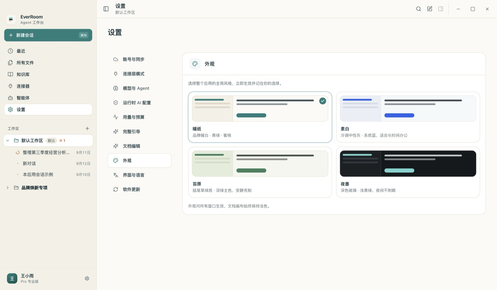
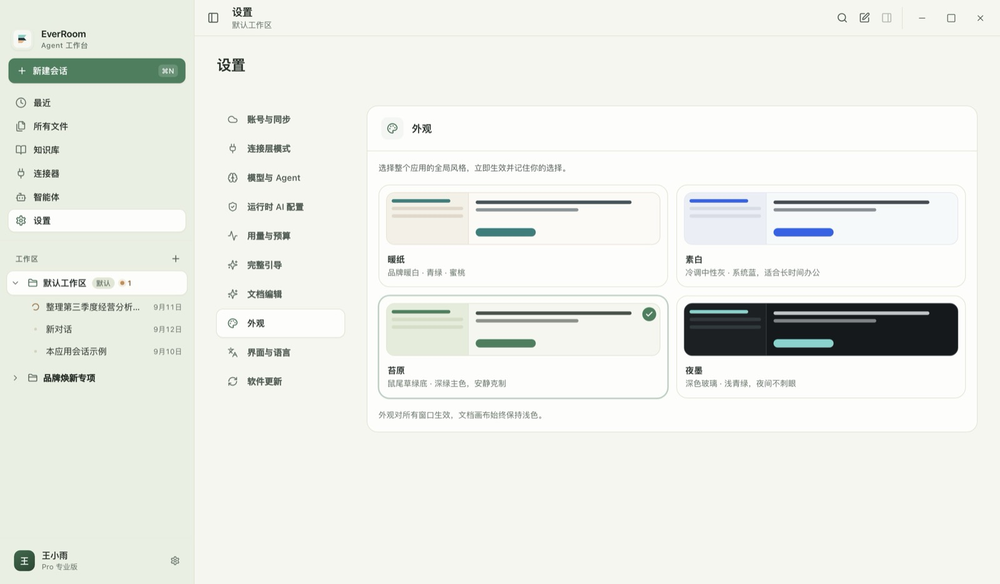

四套风格的首页 / 深色细节：

| 暖纸 | 素白 | 苔原 | 夜墨 |
| --- | --- | --- | --- |
| 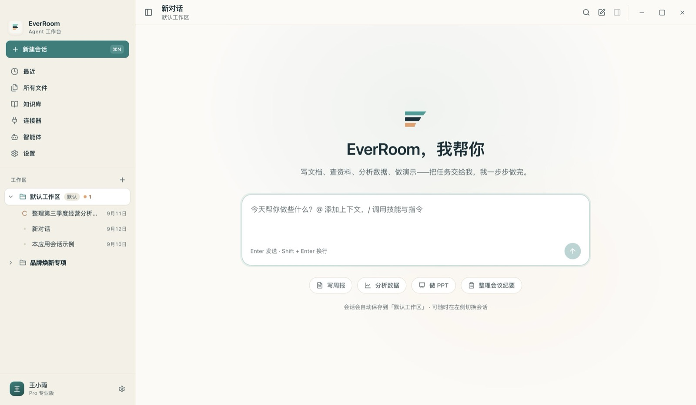 | 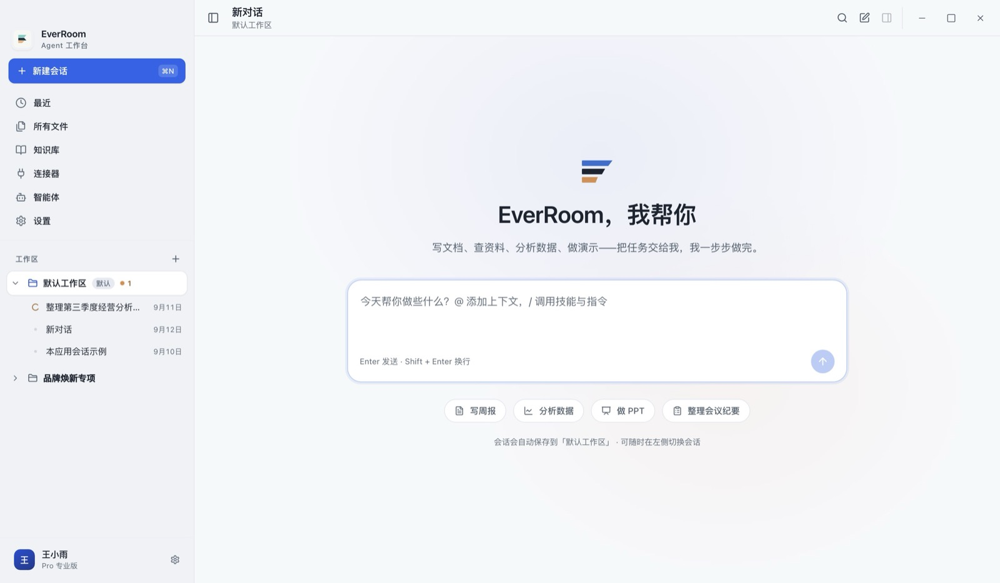 | 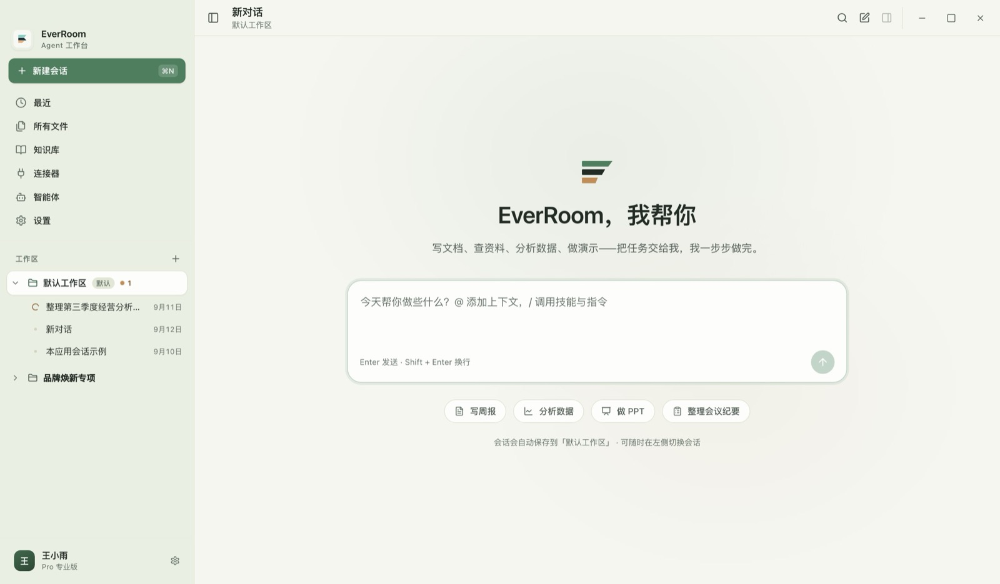 | 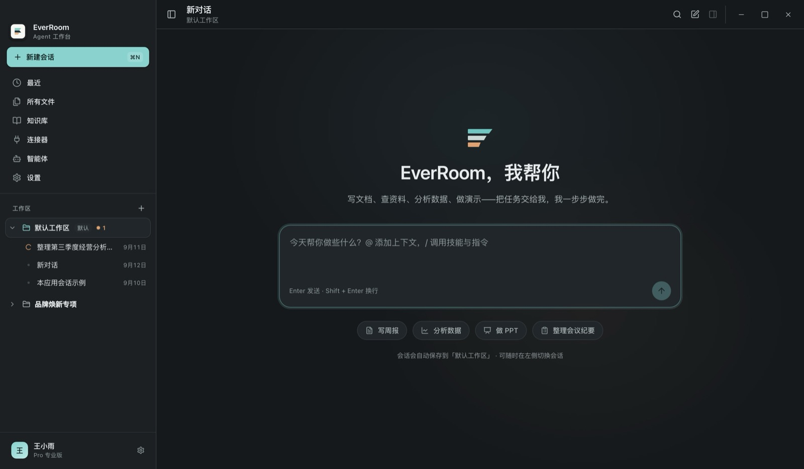 |

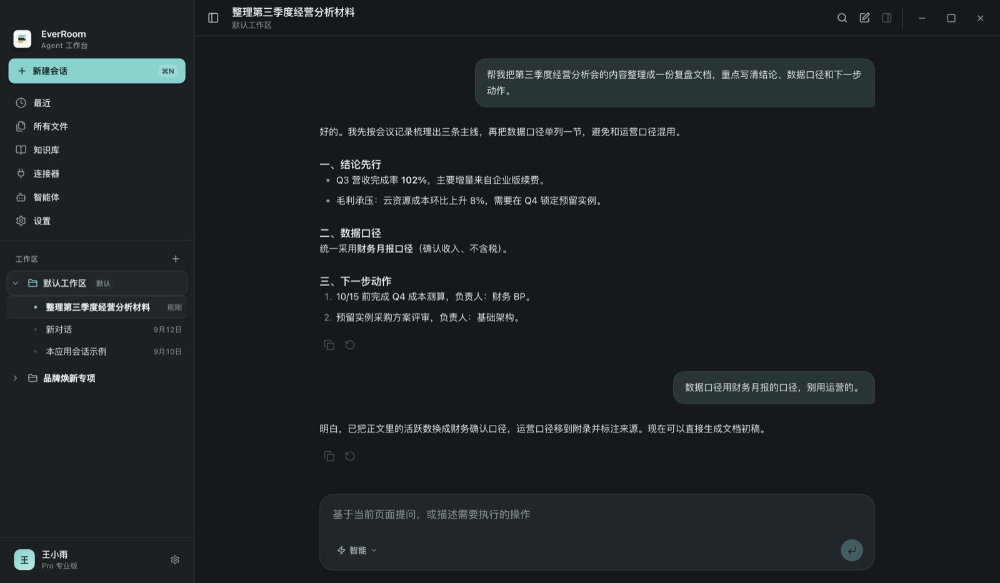
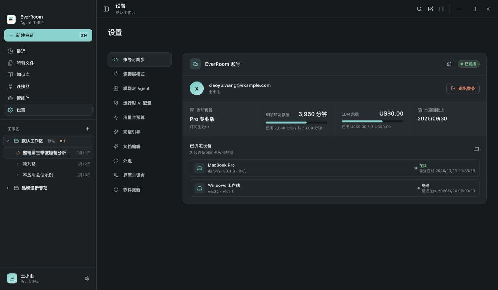
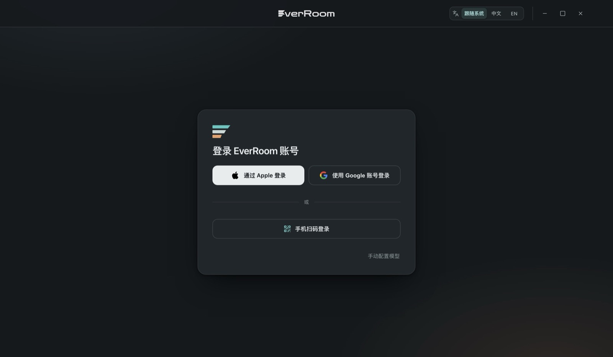

### 实现方式

- **色值**：`styles/themes.css` 按 `:root[data-theme='plain'|'moss'|'night']` 覆盖 `--ui-*`；
  `tokens.css` 的旧别名自动跟随，无需改组件规则。
- **切换**：`state/appearanceSettings.ts` 写入 `<html data-theme data-color-mode>` + `localStorage`，
  即时生效（纯 CSS 变量，不重挂载 React 树）。
- **首帧不闪色**：`renderer/index.html` / `debug.html` 的 `<head>` 内联脚本在首帧前读取偏好并应用主题。
- **主进程跟随**：渲染端把选择镜像到主进程（`main/appearance-store.ts`），
  窗口创建底色与 `nativeTheme.themeSource` 跟着变（深色下缩放窗口不再闪白，系统菜单/对话框也跟随）。
- **深色边界**：文档画布（office 原生视图 / 文档内容）始终保持浅色，符合「深色外壳 + 浅色纸张」的阅读习惯。
- 外观卡片支持方向键切换（`role="radiogroup"` + roving tabindex），`prefers-reduced-motion` 下无过渡。

## 4. 各区域改动

### 4.1 外壳 / 侧栏 / 浮层（`workbench/styles`、`workbench/sidebar`、`workbench/shell`）

- 侧栏重排：品牌区 → 青绿实底「新建会话」（带 ⌘N kbd）→ 页面入口 → 工作区/会话列表 → 账户栏；
  导航/工作区/会话三处选中态统一为白色浮起卡片；运行中会话改用蜜桃呼吸点。
- 顶栏与产物标签栏同高（52px）形成连续标题带；Windows 自绘按钮移到 shell 级 fixed 右上角，
  产物面板展开时不再把按钮挤到窗口中间（`:has()` 留位；macOS 返回 null 不占位）。
- 命令面板、工作区弹窗、会话重命名/删除、toast、tooltip 统一圆角/阴影/遮罩与焦点环。

### 4.2 对话主区（`workbench/conversation`）

- Hero：缎带入场的品牌时刻 + 34px 标题 + 720px 白底大输入框（青绿 focus ring、圆形发送键）+
  白底细描边建议 chips + 极淡青绿/蜜桃光晕。
- 会话态：800px 内容列；用户右对齐浅青绿气泡；助手 markdown 标题/列表/引用/代码块层级化，
  正文 13.5px / 行高 1.75；复制、重试等操作默认弱化，悬停才明显。
- 输入区与 hero 同一视觉语言；「进行中 / 审批 / 错误」统一到蜜桃 / 青绿 / 砖红。

### 4.3 内容页（`office-proto/pages`）

- 内容列 max 1120px、左右 ≥32px；新建卡改 `auto-fit`，在「窗口 1440 + 产物面板打开」的窄内容列下
  自动折成 2 列，不再出现竖排单字。
- 最近 / 所有文件：白卡表格 + 弱化表头 + 52px 行 + 整行 hover；筛选/搜索/视图切换同 36px 高。
- 知识库：去掉 emoji，换 lucide 图标 + 淡色底；连接器：卡片等高、已连接青绿、未连接虚线「+」；
  智能体：补内容区 PageHead，tabs / 记忆列表统一。

### 4.4 设置 / 登录 / 闪屏（`components/pages`、`components/onboarding`、`components/ui`）

- 设置页：184px 设置导航 + 右侧卡片式分区；导航选中为白色浮起卡片（与侧栏同一语言）；
  表单控件统一 36px/9px 圆角；账号卡数据块用 tabular-nums；新增「外观」分区（见第 3 节）。
- 登录门：冷灰改暖纸 + 青绿/蜜桃极淡光晕，登录卡 512px/圆角 20/品牌缎带，
  Apple / Google / 扫码按钮统一 46px；语言分段控件与设置页 segmented-control 同款；
  深色下整条 logo 反白、Apple 标反相以保证可读。
- 启动闪屏保留原有动画，只把背景/文字/投影校准到新 token。

## 5. 验收

- `pnpm --filter @nxcore/desktop typecheck`：通过
- `pnpm --filter @nxcore/desktop test`：79 个测试文件 / 459 个用例全部通过
- `pnpm --filter @nxcore/desktop build`：主进程、preload、renderer 全部构建通过
- 截图：1440×900 与 1180×800 两档 + 产物面板打开态 + 四套风格 + 登录门；无横向溢出
- 交互验收：设置页点外观卡片 → 整个应用即时换肤；刷新后主题持久化；主进程窗口底色跟随

### 改造前 / 后（暖纸默认）

| 场景 | 改造前 | 改造后 |
| --- | --- | --- |
| 首页 hero | 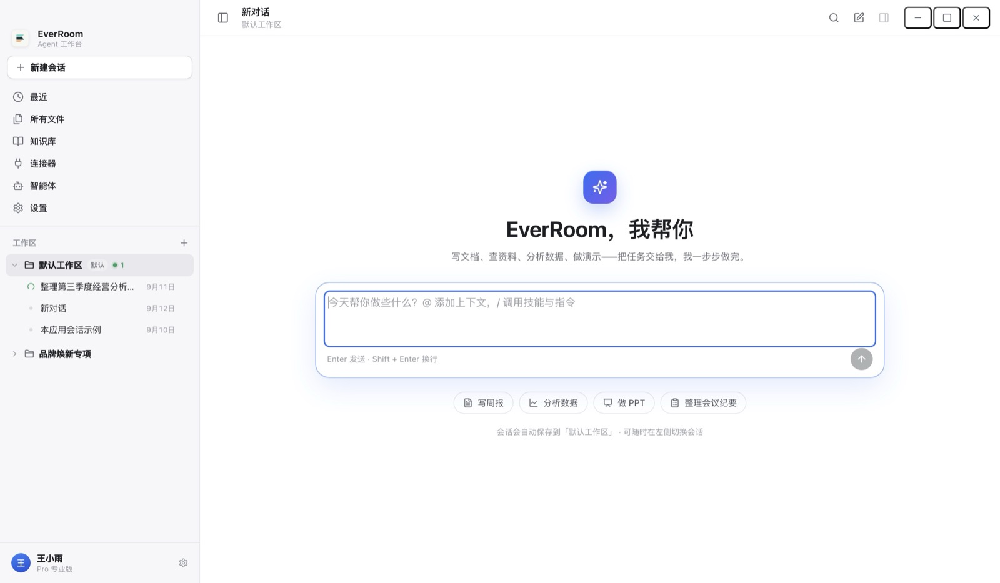 |  |
| 对话 | 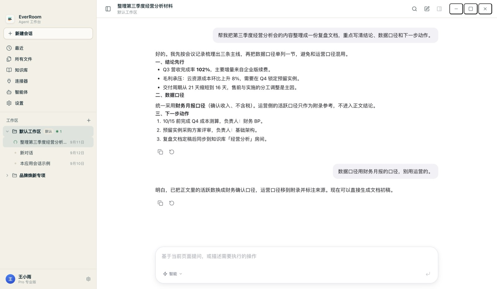 | 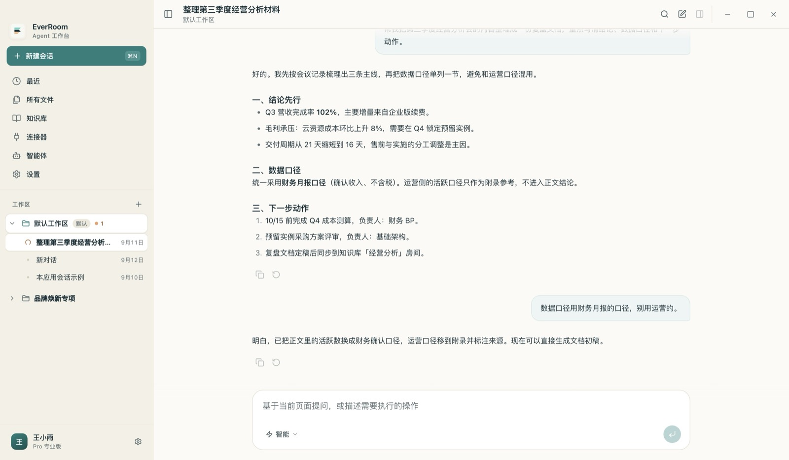 |
| 最近 | 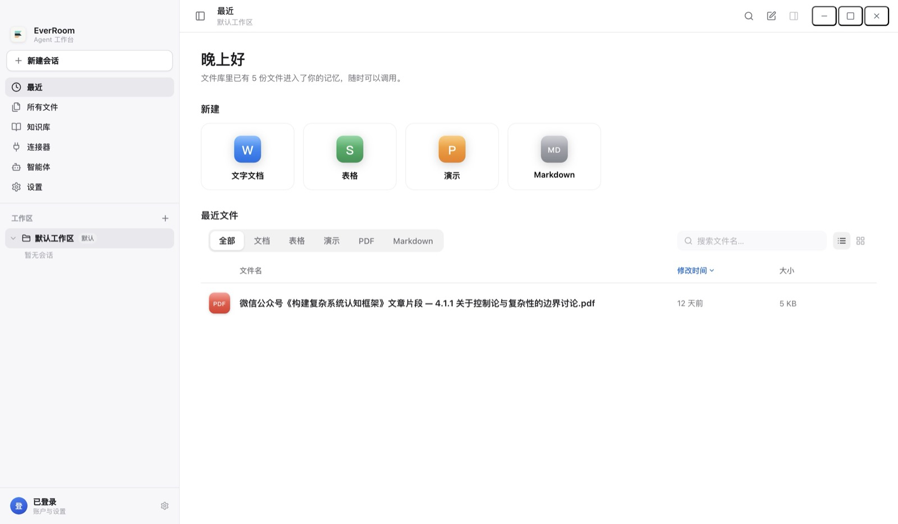 | 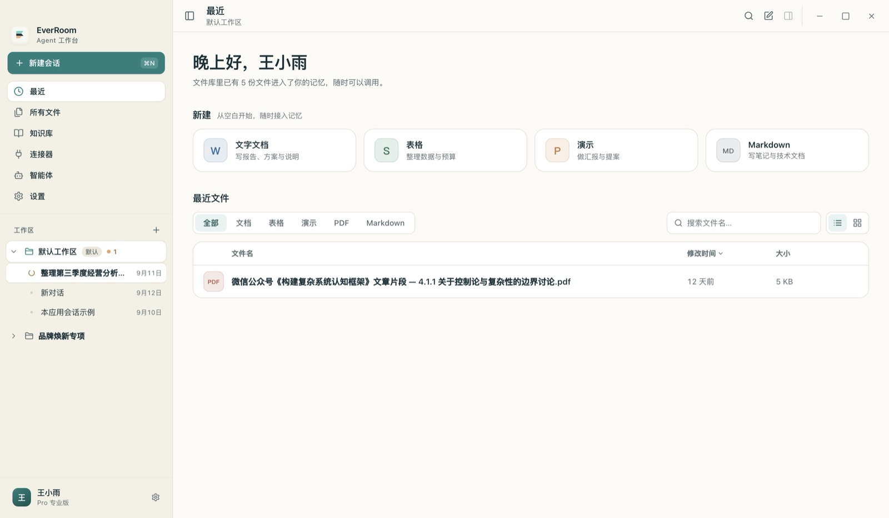 |
| 设置 | 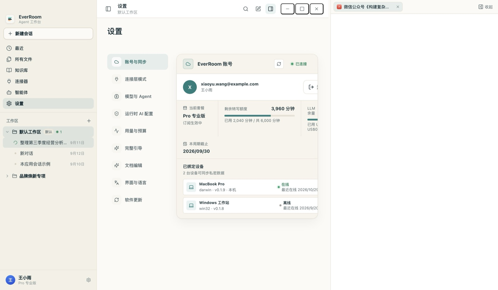 | 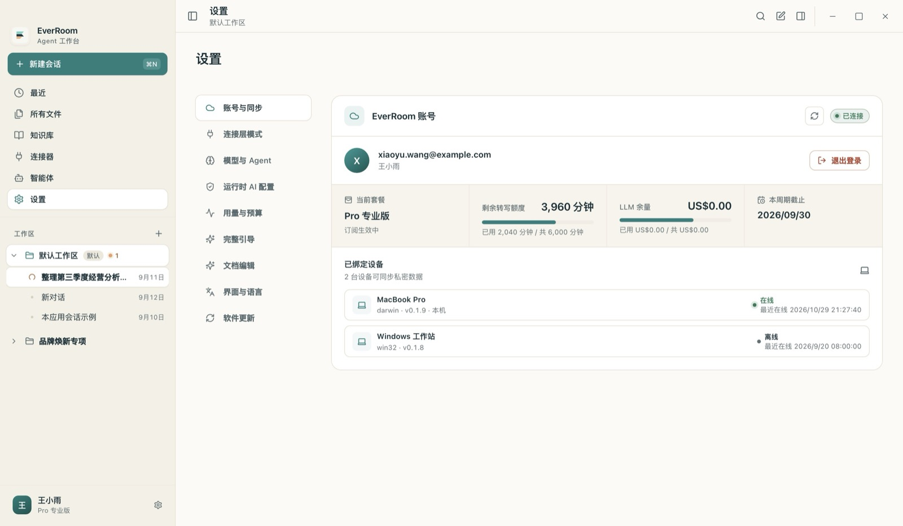 |
| 登录门 | 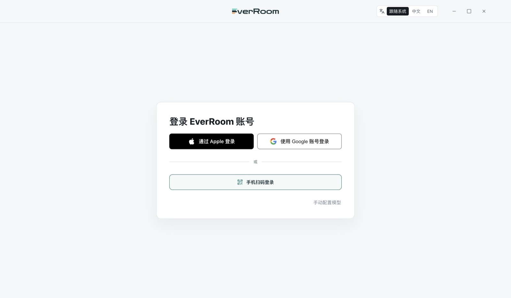 | 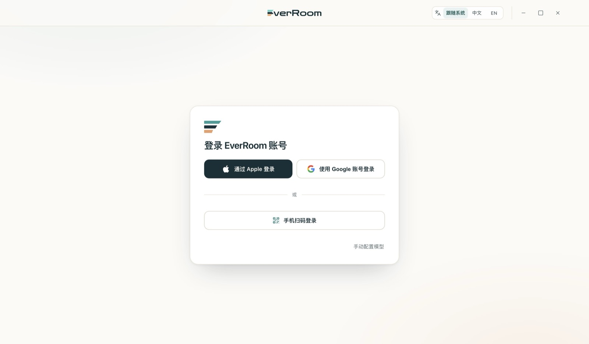 |

更多改造后截图：`docs/assets/ui-refresh/after-*.jpg`；四套风格：`docs/assets/ui-refresh/themes/`。

## 6. 已知边界 / 后续

- 设置页/连接器页的历史 CSS 里仍有少量未被可见处使用的硬编码色；可见区域在四套风格下均已验证。
  深色主题下文档画布保持浅色（设计选择），如需「深色文档」需单独设计编辑器主题。
- 空库空态（无文件 / 无知识库 / 无连接）在浏览器 mock 下会被原型数据兜底，未在 mock 中验证；
  代码路径已按设计实现，建议在真实空库设备上扫一眼。
- 旧 360px 编辑器 Agent 停靠栏（`office-proto/AgentChatDock`）不在本次视觉范围内，未改动。
- 主题目前是 4 套固定风格；后续增加第五套只需在 `themes.css` 加一个 token 覆盖块并在
  `APPEARANCE_THEMES` 里登记（设置页卡片会自动出现）。
