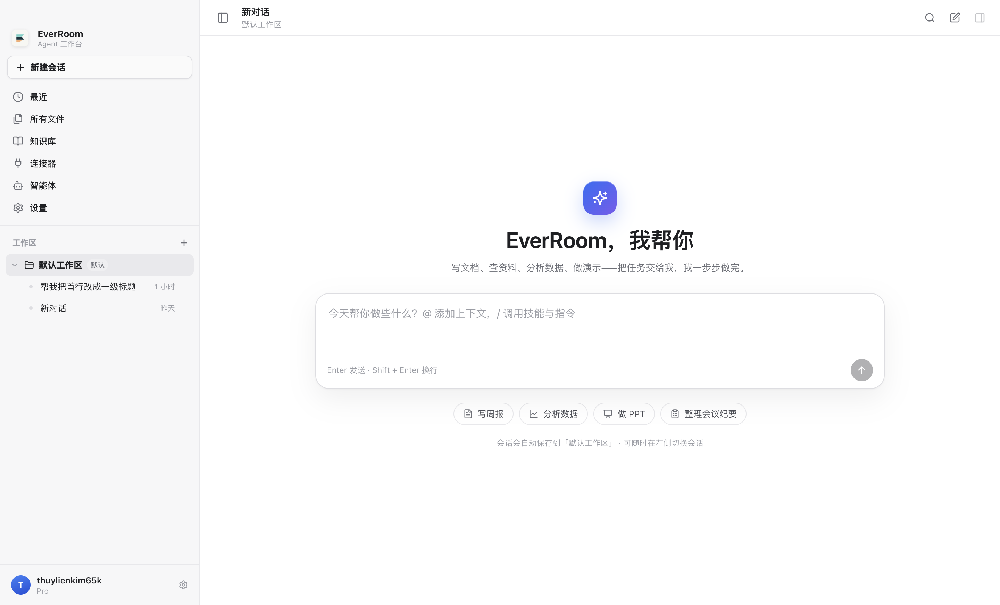
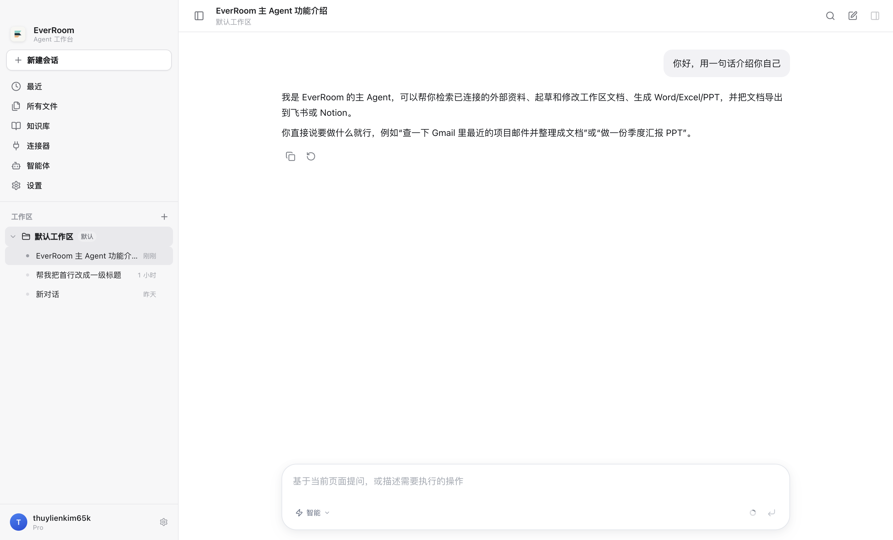
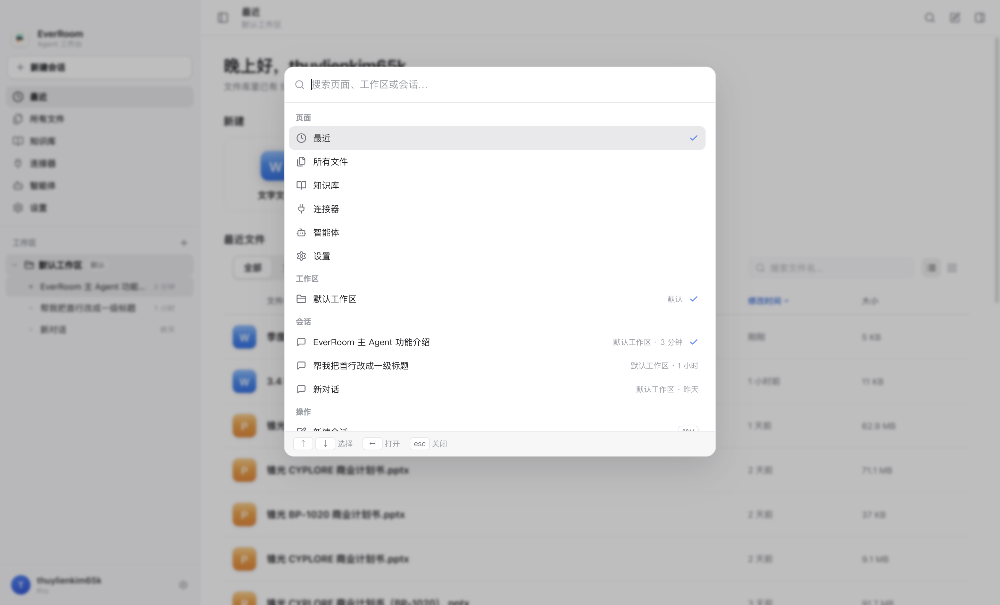
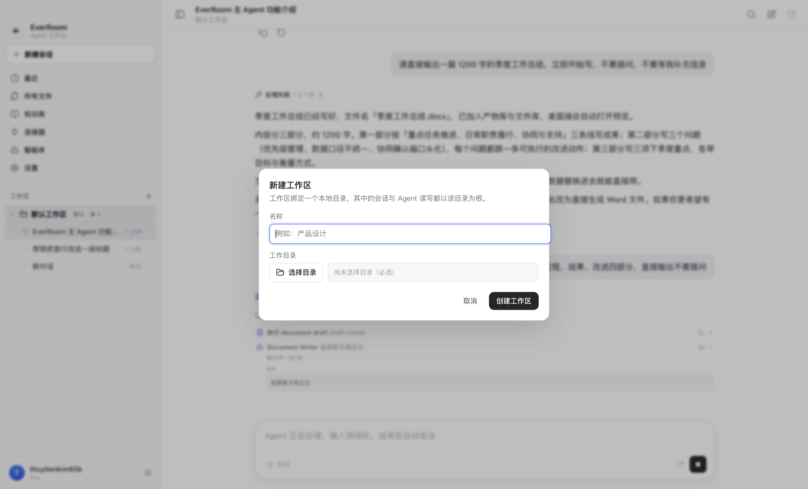
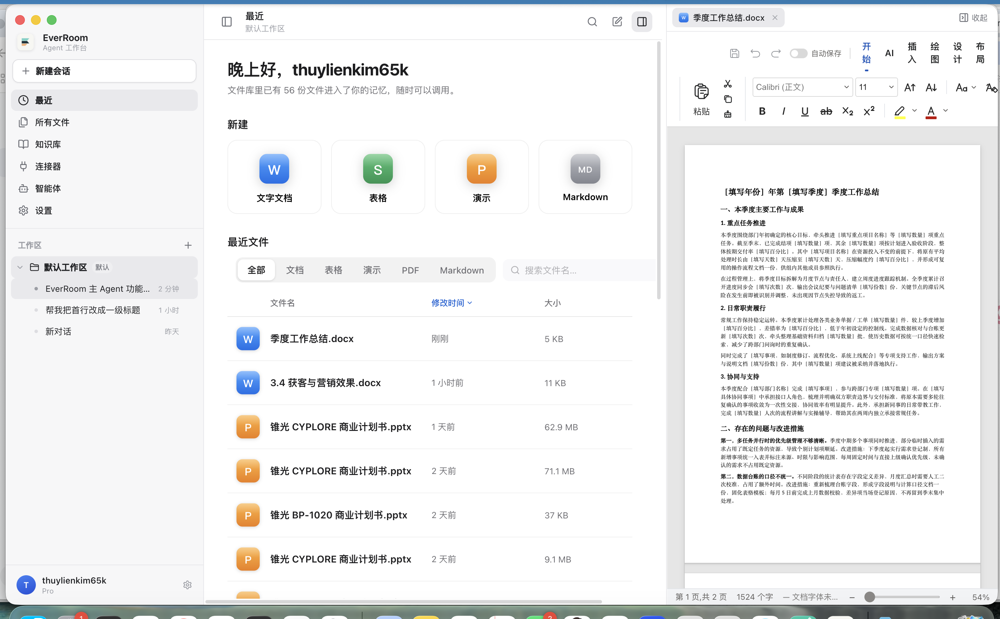

# WorkBuddy 式工作台改造（工作区 + 多会话 Agent）

> **已被取代（2026-10-30）**：外壳已改为「窗口级标签栏 + 主页/工作空间/文件标签 + 互斥双层侧栏」，
> 见 `docs/design/tabs-workbench.zh-CN.md`。本文保留为上一版工作台的数据模型/行为契约记录
>（workspace/session API、后台 run 恢复、产物面板等仍在新外壳里沿用/演进）。

> 状态：**首版已实现并在 macOS dev 实例上真机验收通过**（2026-10-29）。
> 目标：把 EverRoom 桌面端从「Office 原型外壳（顶部标签栏 + 主页侧栏）」改成 WorkBuddy 式「工作区 + 多会话 Agent 工作台」。
> 参考：本机安装的 WorkBuddy 5.9.0（左侧一列导航 + 任务/空间列表 + 右侧大对话区 + 右侧可折叠产物面板）。

## 验收截图

| 场景 | 截图 |
| --- | --- |
| 首页 hero（大输入框 + 建议 chips） |  |
| 多会话对话（后台 run 恢复） |  |
| ⌘K 命令面板 |  |
| 新建工作区（目录型） |  |
| 右侧产物面板（Office 编辑器就在面板里） |  |

真机验证过：首条消息自动建会话、侧栏出现新会话并自动起标题、切到别的会话后 run 继续在网关跑（侧栏 running 计数）、切回会话恢复完整时间线、运行中新建对话进入草稿态且旧任务继续、⌘K 搜索跳转、设置页、最近页打开文档进右侧产物面板、拖拽产物面板宽度后原生编辑器跟随、关闭标签后实例销毁。

## 1. 目标交互

```
┌────────────────────────────────────────────────────────────────────────────┐
│  左侧栏（固定 280px）             主区（占满剩余）          右侧产物面板（默认折叠）│
│  EverRoom 品牌                   ┌ 顶栏：工作区 / 会话标题 ─┐  ┌ 文件标签 ─┐ │
│  [+ 新建会话]                    │                        │  │ Office   │ │
│  最近 / 所有文件 / 知识库 / 连接器 │  对话区（默认）           │  │ 编辑器   │ │
│  ── 工作区 ──                    │  空态 = hero + 大输入框   │  │          │ │
│  默认工作区（默认选中）            │  会话 = 消息流 + 输入框    │  │          │ │
│    会话 A ●运行中                 │                        │  │          │ │
│    会话 B                        │  页面（最近/文件/…）       │  └──────────┘ │
│  工作区 2（目录）                  └────────────────────────┘                │
│    会话 C                                                                    │
│  账户 / 设置                                                                 │
└────────────────────────────────────────────────────────────────────────────┘
```

- **左侧一列**：品牌 + 新建会话 + 页面入口 + 工作区列表（默认工作区永远存在、可新建/重命名/删除）+ 当前工作区下的会话列表（标题/相对时间/运行中状态）。
- **主区默认是对话**：空态是 WorkBuddy 式 hero（问候 + 大输入框 + 建议提示词）；选中会话后是完整 agent 对话（消息、工具时间线、审批、排队发送、模型/权限档位）。
- **一个工作区 → 多个会话**；多个会话可以同时有 run 在跑。切换会话/切换到页面不取消 run（网关侧 run 独立于渲染层，回到会话时从快照 + 事件全量恢复）。
- **右侧文件（产物）面板**：平时折叠，顶栏按钮 / ⌘J 常驻可点（没有产物也能打开）；没有标签时面板直接列出**文件库（产物库）里的文件**（按更新时间倒序取最近 200 个，可搜索），点一行就在面板里打开成标签；从页面点文件也会自动展开并激活对应标签。面板可拖拽调宽，可关闭但保留标签。
- **页面入口**：最近 / 所有文件 / 知识库 / 连接器 / 智能体 / 设置，点击在主区显示，可返回对话。

## 2. 数据模型

网关 SQLite 新增 `agent_workspaces`：

| 字段 | 说明 |
| --- | --- |
| id | text pk；默认工作区固定 `default` |
| name | 显示名 |
| path | 本地目录；默认工作区为 null（应用托管），自定义工作区必须是绝对路径 |
| kind | `default` \| `custom` |
| created_at / updated_at / last_opened_at | 毫秒时间戳 |

`agent_sessions` 增加 `workspace_id`（text，索引）。存量会话回填为 `default`。

### API / 类型（渲染层按此消费）

```ts
interface AgentWorkspace {
  id: string; name: string; path: string | null
  kind: 'default' | 'custom'
  createdAt: string; updatedAt: string; lastOpenedAt: string
}
interface CreateAgentWorkspaceInput { name: string; path?: string | null }
interface UpdateAgentWorkspaceInput { name?: string; path?: string | null; lastOpenedAt?: string }

// AgentSession 增加 workspaceId: string | null
// CreateAgentSessionInput 增加 workspaceId?: string | null
```

preload：`window.nxcore.workspace = { list, create, update, remove, pickDirectory }`。
渲染层会话统一用 `pageLabel: 'Agent'` + `workspaceId` 分区；列表用 `agent.listSessions()`（不带 pageLabel）后按 workspaceId 过滤。

## 3. 渲染层结构

`apps/desktop/src/renderer/src/workbench/`

| 路径 | 职责 | 负责人 |
| --- | --- | --- |
| `types.ts` | UI 类型（PageKey/View/ArtifactTab 等） | Lead |
| `api.ts` | `window.nxcore.workspace` / `agent` 的渲染层适配 | Lead |
| `state/store.ts` | zustand 工作台状态（workspaces/sessions/active/view/artifacts/轮询） | Lead |
| `styles/workbench.css` | WorkBuddy 视觉 token、布局、顶栏、页面宿主 | Lead |
| `shell/Workbench.tsx` | 顶层壳：ResizablePanelGroup + boot + 轮询 + 快捷键 + 弹窗挂载 | Lead |
| `shell/MainHeader.tsx` | 主区顶栏（工作区/标题/搜索/新建/产物面板开关） | Lead |
| `shell/PageHost.tsx` | 复用 office-proto 页面 + 真实 SettingsPage | Lead |
| `shell/Toaster.tsx` | 轻量 toast（可选） | Lead |
| `sidebar/Sidebar.tsx` | 左侧栏：导航、工作区、会话、账户 | Sidebar |
| `sidebar/WorkspaceDialog.tsx` | 新建/重命名工作区弹窗（目录选择） | Sidebar |
| `sidebar/CommandPalette.tsx` | ⌘K 搜索/切换工作区与会话（cmdk） | Sidebar |
| `sidebar/sidebar.css` | 左栏样式 | Sidebar |
| `conversation/ConversationPane.tsx` | 对话主区：useAgentSession + AgentChatView/Composer/Toolbar | Conversation |
| `conversation/ConversationEmpty.tsx` | hero 空态 + 建议提示词 | Conversation |
| `conversation/conversation.css` | 对话样式（覆盖 AgentChat 旧面板壳） | Conversation |
| `artifacts/ArtifactPanel.tsx` | 右侧文件面板：标签栏 + 编辑器宿主 + 文件库列表切换 + 折叠轨 | Artifact |
| `artifacts/FileLibraryList.tsx` | 面板空标签时的文件库列表（最近 200 个 / 搜索 / 点击打开） | Artifact |
| `artifacts/ArtifactView.tsx` | 纯编辑器（从 office-proto EditorView 抽出，去掉 Agent 停靠） | Artifact |
| `artifacts/artifacts.css` | 产物面板样式 | Artifact |

组件依赖的公共能力：

```ts
// store.ts
useWorkbenchStore(): {
  workspaces, sessions, activeWorkspaceId, activeSessionId, view,
  artifactScopes, sidebarCollapsed,          // 产物面板按上下文（会话/页面）各记一套
  useArtifactScope(),                        // 读当前上下文 { artifacts, activeArtifactId, open }
  boot(), refresh(), selectWorkspace(id), createWorkspace(input), renameWorkspace(id,name), deleteWorkspace(id),
  createSession(workspaceId?), selectSession(id|null), syncActiveSession(session|null),
  renameSession(id,title), deleteSession(id), openPage(page), showConversation(),
  openArtifact(file), closeArtifact(id), activateArtifact(id), setArtifactOpen(open), toggleSidebar()
}
```

## 4. 关键行为

1. **后台继续**：切换会话/页面只 unsubscribe 事件流，不调用 cancelRun；网关 run 继续，`agent_events` 持久化。回到会话时 `getSession` + 每个 run 的 `getEvents` 重建完整时间线。侧栏轮询 `listSessions()` 显示 running 状态。
2. **新建会话**：点「新建会话」进入草稿态（不立刻建库），首条消息发出时创建（`workspaceId` 归属当前工作区）；侧栏「+」直接建空会话也可。
3. **切换会话**：点侧栏会话 → `store.selectSession(id)`，对话区 `selectSessionById` 恢复；另一会话的 run 不受影响。
4. **产物 / 文件面板**：任何页面里点文件 → `openArtifact(file)` → 右侧面板展开并激活对应标签；编辑器使用 `NativeEditorHost` 的矩形上报机制，面板拖拽/resize 时会自动重报 bounds。
   面板按钮常驻可点：当前上下文没有标签时打开面板 → `FileLibraryList` 直接列出文件库（产物库）最近更新的 200 个文件，点击就在面板里打开；已打开标签时可点标签栏左侧的文件夹按钮切回列表。
   **标签按上下文隔离**：每个会话（含新对话草稿）和每个页面各记一套打开的标签 / 激活标签 / 展开状态；
   切到别的会话或页面不显示不属于该上下文的标签，切回来原样恢复（删会话/删工作区时对应作用域一并清掉）。
5. **关闭窗口**：维持现状（退出 App）。本次不做托盘常驻。

## 5. 验证

- 类型检查：`node apps/desktop/node_modules/typescript/bin/tsc -p apps/desktop/tsconfig.json --noEmit`
- 单测：`node apps/desktop/node_modules/vitest/vitest.mjs run <files>`（apps/desktop 目录下）
- 网关：`node apps/gateway/node_modules/typescript/bin/tsc -p apps/gateway/tsconfig.json --noEmit`
- 开发运行：`pnpm --filter @nxcore/desktop dev`（需要完整权限；沙箱里 pnpm 会被拒，Lead 负责最终运行验收）。

## 6. 约束

- 不重写已有 agent 协议/网关 run 机制；只加 workspace 维度。
- 复用 `office-proto` 页面与 `AgentChatView` / `AgentComposer` / `AgentToolbar` / `useAgentSession`，不另造对话轮子。
- 交互组件优先用已安装开源件：Radix UI（tooltip/scroll-area/tabs/collapsible/avatar/separator/dialog/dropdown-menu/popover/context-menu）、cmdk、react-resizable-panels、zustand、lucide-react。
- 不碰 `apps/gateway` 之外无关模块；不提交 git；不动别人的未提交改动。